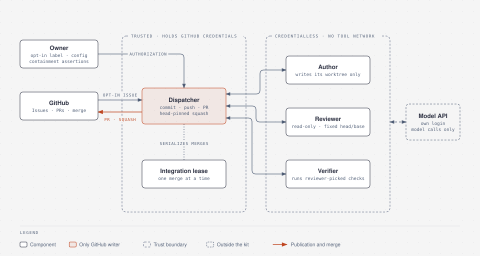

# Agentic Delivery Kit

[](https://github.com/mg-mg-mg/agentic-delivery-kit/actions/workflows/ci.yml)

**Why this exists:** AI coding agents write code fast, but speed only helps if their output can be trusted. This kit is a synthetic reference implementation of an earlier dispatcher-based delivery model, plus reusable guards, a cooperative lease, governance checks and source-grounded navigation. It contains no product code or private operational records.

The dispatcher is retained as a constrained working example, not a description of today's production workflow. The companion [Agentic Engineering case study](https://github.com/mg-mg-mg/agentic-engineering) describes current practice.

## Start here: local verification

Run the synthetic reference checks locally, without GitHub credentials or a model runtime. Activation and containment prerequisites are covered in [Configuration and safe start](#configuration-and-safe-start).

Requires macOS or Linux, Python 3.11+, Git, `uv` and ripgrep (`rg`, used by publication-scan tests). No GitHub/Codex login or model runtime is needed. The first dependency download may take longer; network access is only needed for the public clone and development dependencies.

Run this as one block: `&&` stops at the first failed step, before any later check.

```sh
git clone --depth 1 https://github.com/mg-mg-mg/agentic-delivery-kit.git &&
cd agentic-delivery-kit &&
uv sync --group dev &&
uv run pytest -q &&
uv run ruff check . &&
uv run python -m delivery_kit.dispatcher --config kit.toml
```

The final command is a **configuration-only dry run**. Expect `"repository": "example/demo"`, `"enabled": false` and `"mode": "configuration-only"`. It does not contact GitHub, start model work or install timers. Stop on any error; do not add `--execute` to troubleshoot.

To inspect a concrete failure-stop case, run the existing mocked verifier-failure regression:

```sh
uv run pytest -q tests/test_dispatcher_audit.py \
  -k 'failed_phase_stops_later_ticks and verification_failed'
```

This test should pass: failed verifier evidence blocks the lane, and the next tick stops without another role call. It does not run a model. See [CI](https://github.com/mg-mg-mg/agentic-delivery-kit/actions/workflows/ci.yml) for full-suite results and [Configuration and safe start](#configuration-and-safe-start) for activation prerequisites and limits.

## Reference architecture

<picture>
  <source media="(prefers-color-scheme: dark)" srcset="assets/trust-boundaries-dark.svg">
  
</picture>

Order of one task: opted-in Issue → author → dispatcher commits and publishes → separate read-only reviewer → credentialless verifier → fixed-head guarded squash merge → parent and tree reconciliation.

In this reference, only the trusted dispatcher has GitHub access. Model roles cannot commit, publish, change accounts, or deploy. The author edits a dedicated worktree. A fresh read-only role reviews exact head and base commits and specifies checks. A separate verifier executes those checks without general host credentials or tool networking. The dispatcher validates structured evidence, current issue eligibility, the PR head/base and remaining criteria before a head-pinned squash merge. It verifies the resulting parent and tree afterward.

The lease serializes cooperating local integration commands. It deliberately remains after mutation-path failure, but read-only merge refusals release it. Queue claims and worker locks prevent duplicate local authors. Finite pass/phase/repair budgets, terminal stopped lanes, disk/file limits and bounded private diagnostics constrain unattended work. These controls do not block independent remote writers.

## Configuration and safe start

Requires macOS or Linux (POSIX), Python 3.11+, Git, the GitHub CLI, a compatible Codex CLI, and an HTTPS origin matching the configured repository. Runtime modules use only the standard library. Development checks use pytest and Ruff.

The role-launch adapter supports the Codex CLI only. There is no OMP adapter; changing the command name does not migrate its arguments or permission profiles.

```sh
uv sync --group dev
uv run pytest -q
uv run ruff check .
python -m delivery_kit.dispatcher --config kit.toml
python -m delivery_kit.navigation --source examples/navigation --graph examples/navigation/graph.json --baseline examples/navigation/baseline.json
```

Before publication, run `bash scripts/check-publication.sh`. Its offline, nonsecret default policy rejects common private home paths, session-shaped UUIDs and credential/email patterns. An owner-reviewed `DENIED_TERMS` expression can replace the default for a specific publication review. Content, authors and taggers allow only the exact synthetic CI address and approved owner GitHub noreply identity; committers additionally allow GitHub's own noreply identity for hosted merges. Historical commit identity emails are exempt only through the pinned published snapshot; every annotated tag's tagger identity must be approved regardless of its target. Commit messages, names and blobs remain checked. This bounded scan is not a secret-free certification.

If historical tag identities ever need grandfathering, pin the approved tag-object SHAs, not their target commits.

The default command validates configuration only. It does not contact GitHub or start model work. **Execution and timer installation are disabled by default.** Copy `kit.toml` to the ignored `local.toml` and configure the target checkout, repository owner/name, label policy, optional Project fields/options, names, state location, model/effort, worker count and limits. Set `launch.path` to a nonempty list of absolute directories containing Git, `gh` and the configured agent command; rendered timers use that explicit PATH rather than an interactive shell's environment. All deployment-specific settings belong in that one file. Secrets never belong there.

Before enabling, validate the installed CLI's named permission profile on a disposable checkout: tool networking denied, secret-file reads denied, author writes confined to its checkout, reviewer writes denied, Git metadata writes denied, user hooks/apps disabled. Separately validate OS-level containment of every descendant for the role's lifetime, including detached sessions and immediate parent exits; process-group cleanup does not provide it. The Codex inference broker still needs its own login and model connectivity. “Offline” describes tools and checks, not inference transport. Both `permissions_validated` and `process_containment_validated` are required owner assertions, not sandbox audits performed by this package.

Only after this validation and an authorization covering the target repository's publishing and merging:

```sh
python -m delivery_kit.dispatcher --config local.toml --worker 1 --execute
python -m delivery_kit.launch --config local.toml --render state/timers
# macOS only, explicitly changes the user's LaunchAgent configuration:
python -m delivery_kit.launch --config local.toml --install
```

Add the configured opt-in label only to fully specified, authorized tasks. Holds, unresolved prerequisites, ambiguous metadata, existing ownership, failed checks, stale heads/bases, and incomplete criteria stop delivery. [Delivery policy](docs/delivery.md) explains recovery and limitations. [Navigation evaluation](docs/navigation.md) explains source-grounded trust measurement and adapters.

## Limitations

- Timer installation is macOS LaunchAgent-specific. Tests are credentialless and synthetic, not evidence of a live Codex/GitHub delivery.
- CLI permission interfaces evolve. No compatibility fallback disables isolation. Validate the installed release before enabling.
- Native dependency API or Project access failures stop selection. Project fields are read-only: configured single-select field definitions and required options must exist before selection. An empty dispatch value is permitted only after schema validation; CLI JSON names must match configured display field names.
- This intentionally smaller reference leaves Issue closing, Project mutations, automatic rebases, notifications and worktree cleanup to explicit owner actions.
- Models can misjudge criteria or fabricate observations. Separate roles and source checks reduce risk but are not formal proof. Do not enable against untrusted repositories or issues requiring deployments, irreversible changes, private data or external messages.
- GitHub pins the merge head, not the base. A competing remote update can only be detected afterward. An unexpected parent/tree requires manual reconciliation, never automatic rollback.

See [Agentic Engineering](https://mg-mg-mg.github.io/agentic-engineering/) for the broader approach. See [SECURITY_REVIEW.md](SECURITY_REVIEW.md) for the actual checks and unverified boundaries of this extraction.
